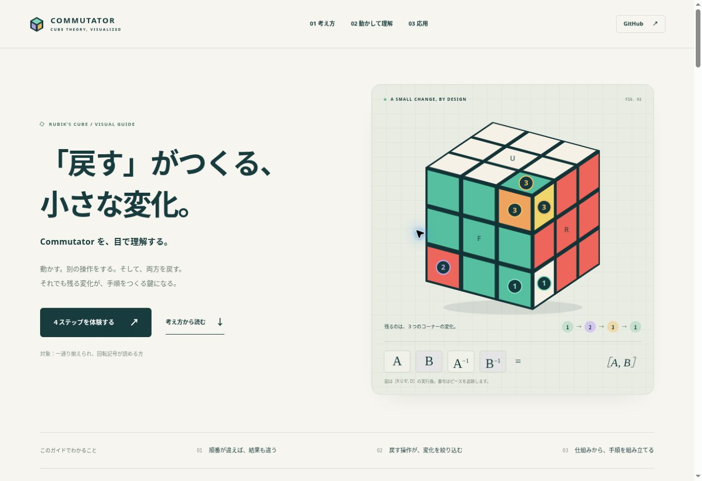

# COMMUTATOR — キューブの交換子を、目で理解する。

ルービックキューブを一通り揃えられ、回転記号を読める人向けの日本語学習サイトです。交換子の意味を、正確な3Dキューブ、位置の模式図、54ステッカーの6面展開図で説明します。

公開時のURL：<https://shujiyoneda.github.io/Commutator-/>

## 最初の公開：設定を1回保存する

サイト一式は **mainブランチのルート**に配置済みです。以下の設定を保存すると、GitHub Pagesで公開できます。

1. [GitHub Pagesの設定画面を開く](https://github.com/shujiyoneda/Commutator-/settings/pages)。GitHubのログイン済みアカウントで開いてください。
2. **Build and deployment** 内の **Source** を **Deploy from a branch** にします。
3. **Branch** の左の選択欄で **main**、右のフォルダー選択欄で **/(root)** を選びます。
4. **Save** をクリックします。
5. 公開処理が完了したら、同じ画面の公開URLまたは **Visit site** を開きます。

| 設定項目 | 選ぶ内容 |
| --- | --- |
| Source | Deploy from a branch |
| Branch | main |
| フォルダー | /(root) |

公開URL：<https://shujiyoneda.github.io/Commutator-/>

公開直後に404が表示される場合は、**Actions** タブで公開処理の完了を確認してから再読み込みしてください。以降はmainブランチのファイル更新で再公開されます。



## 学習内容

- 操作の順番による違い：`R U` と `U R`
- 交換子 `[A,B] = A B A^-1 B^-1` の4段階（左から実行）
- 逆手順は「順序を逆にし、各回転も逆にする」
- コーナー3点巡回 `[R U R', D]`
- エッジ3点巡回 `[M2, U R U']`
- `[R,U]` は3エッジと4コーナーを変える反例
- `[R,L]` は可換で、恒等操作になる例
- `[A,B]^-1 = [B,A]` と逆巡回
- セットアップによる共役 `S [A,B] S^-1`

## 操作

実例を選択し、再生、停止、1手送り、巻き戻し、任意の段階への移動ができます。キューブはドラッグまたは視点ボタンで方向を変更できます。模式図ではコーナー／エッジの表示を切り替えられます。

「6面展開図」で見えない面とピースの向きを確認できます。「自分のA・Bで試す」では任意の交換子を入力できます。使用可能な記号は `U R F D L B M E S x y z` と `'`、`2` です。MはL、EはD、SはFと同方向。括弧やワイド回転は非対応です。

## 正確性と表現範囲

`cube.js` は、54枚のステッカーを整数座標の位置ベクトルと法線ベクトルで保持し、正確な90度回転で更新します。3D図、模式図、展開図、ピース数、巡回表示は、すべて同じ状態から生成します。回転の途中だけは描画用の角度補間を使います。

- 白=U、赤=R、緑=F、黄=D、橙=L、青=Bから開始します。
- 位置名は `UFR`、`DFR` など面の組み合わせです。
- 模式図の配置は抽象的です。向きは省略し、色と向きは3D図・展開図で確認します。
- 番号は元のピースに付いて移動します。同じ番号が複数の面に現れる場合、それは同じピースです。
- 通常の無地センターの3×3×3を対象とし、センターの自転はモデル化していません。センターの位置移動は追跡します。
- 交換子が常に純粋な3点巡回になるわけではありません。

## 検証

外部パッケージは不要です。Node.js 20以降で実行できます。

```sh
npm test
```

18テストにより、各面の時計回り方向、F/R/Uの隣接面ステッカー移動、12種類の基本回転と逆操作、全体回転とスライス回転の関係、複合逆手順、不正入力、500手のランダム操作におけるピース保存、実例の3点巡回と他の全ステッカーの復元、交換子の逆、セットアップ後の対象位置、展開図の54枚などを検証しています。

コーナー実例の検証結果：`UFR → DFR → DFL → UFR`。他の5コーナーと12エッジは位置・向きとも復元。3回の反復で対象の向きも含めて完成状態に戻ります。

エッジ実例の検証結果：`UB → FR → DF → UB`。他の9エッジと全コーナーは位置・向きとも復元。3回の反復で完成状態に戻ります。

## ローカル表示

ビルドや依存ライブラリは不要です。静的HTTPサーバーでこのディレクトリを配信します。ES Modulesを使用するため、`file://` での直接表示は避けてください。

```sh
python3 -m http.server 8080
```

ブラウザーで `http://localhost:8080` を開きます。

## GitHub Pages

公開ソースは **main / (root)** です。初回はリポジトリの **Settings → Pages → Deploy from a branch → main → /(root) → Save** で有効化します。以降はmainのファイル更新で再公開されます。`.nojekyll` により、静的ファイルをそのまま配信します。

## ファイル

| ファイル | 役割 |
| --- | --- |
| `index.html` | 日本語解説とインターフェース |
| `style.css` | デスクトップ・モバイル対応のレイアウト |
| `cube.js` | 正確なステッカー回転モデル |
| `render.js` | 3D図、模式図、展開図のSVG生成 |
| `app.js` | 再生・入力・共役・同期処理 |
| `tests/cube.test.js` | モデルと実例の検証 |

トラッキング、外部CDN、外部JavaScriptライブラリ、ログイン、バックエンドは使用しません。

## 参考資料

理論・記法を確認するために参照しています。本文と図は本サイトのオリジナルです。

- [Jaap's Puzzle Page — Useful Mathematics](https://www.jaapsch.net/puzzles/theory.htm)
- [Techniques to Build Rubik's Cube Algorithms](https://math.utoledo.edu/~niverso/algs.html)
- [WCA Regulations — Notation](https://www.worldcubeassociation.org/regulations/#article-12-notation)
